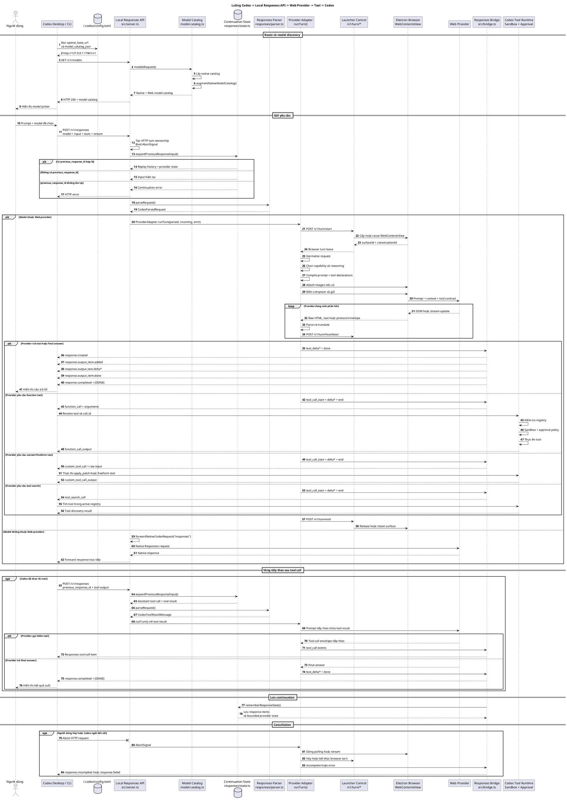
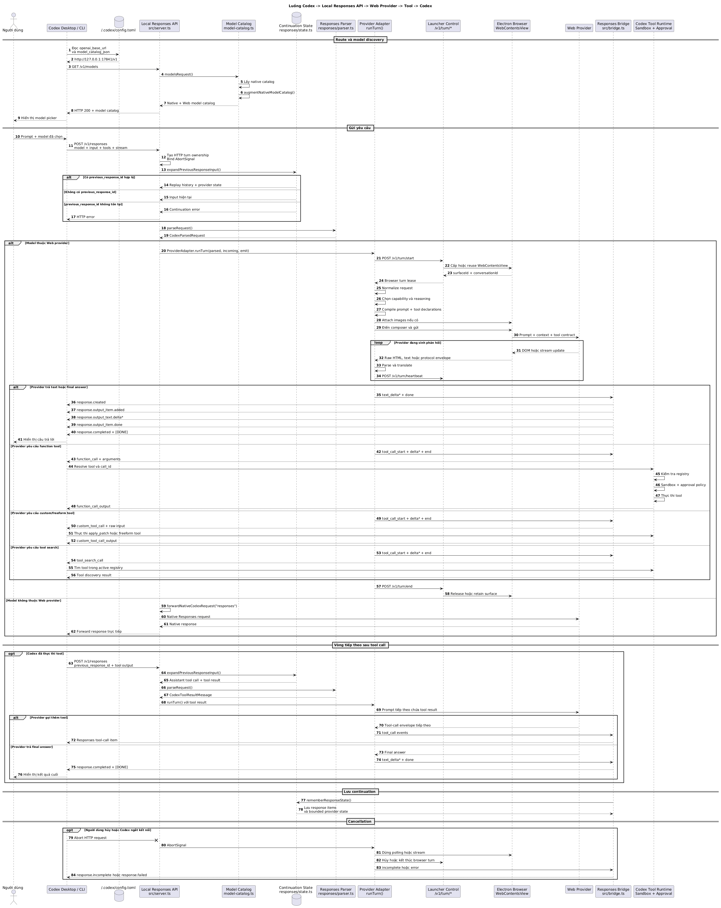

# Kiến trúc hệ thống Codex Web GPT

> **Status:** Current
>
> **Last verified:** 2026-11-05
>
> **Verified against commit:** `7a36e2b`
>
> **Project version:** `6.9.5`
>
> **Source of truth:** Source code, tests, `package.json` và `launcher/package.json`

## 1. Phạm vi tài liệu

Tài liệu này mô tả kiến trúc đang được thể hiện trực tiếp trong mã nguồn:

- Local Responses API server.
- Provider routing và adapter contract.
- Các Web Adapter hiện có.
- Native Codex passthrough.
- Responses continuation và compaction.
- Electron Launcher và browser surface ownership.
- Logging vận hành tối thiểu.
- Build, test và architectural gates.

Tài liệu không mô tả lại chi tiết selector DOM, prompt template hoặc từng model cụ thể. Các nội
dung đó thay đổi thường xuyên và phải được đọc từ source cùng regression tests tương ứng.

## 2. Tổng quan hệ thống

```text
Codex Desktop / Codex CLI
          |
          | HTTP trên loopback
          v
Local Responses API Server
          |
          +-- GET  /v1/models
          +-- POST /v1/responses
          +-- POST /v1/responses/compact
          +-- POST /v1/alpha/search
          +-- POST /v1/images/generations
          +-- POST /v1/images/edits
          |
          +-- Web provider route
          |      |
          |      +-- ChatGPT Web
          |      +-- Microsoft 365 Copilot
          |      +-- Gemini Web
          |      +-- Google AI Studio
          |      +-- Qwen Web
          |
          +-- Native Codex passthrough
                 |
                 +-- Responses
                 +-- Compact
                 +-- Search
                 +-- Image generation/editing

Electron Launcher
          |
          +-- Runtime supervision
          +-- Embedded browser surfaces
          +-- Browser turn control server
          +-- Codex integration setup
          +-- MCP/tunnel setup where applicable
          +-- Updates, state and local operational logging
```

## 3. Luồng end-to-end từ Codex tới Web Provider

Phần này mô tả đường đi thực tế của model discovery, user request, assistant response và tool call.
Đây là luồng giúp một yêu cầu được nhập trong Codex đi qua Local Responses API Server, tới Web
Provider, rồi quay lại Codex dưới Responses API contract.

### 3.1. Bước cài route vào Codex

Codex không tự phát hiện Local Responses API Server. Setup gọi
`installCodexIntegration()` để cập nhật `~/.codex/config.toml`.

Cấu hình mặc định tương đương:

```toml
openai_base_url = "http://127.0.0.1:17841/v1"
model_provider = "openai"
model_catalog_json = "/đường/dẫn/tới/model-catalog-do-runtime-quản-lý.json"
```

Luồng cài đặt:

```text
Launcher: Install models / Reinstall
          |
          v
src/setup.ts
  setup()
          |
          +-- tạo hoặc cập nhật AppConfig
          |     host = 127.0.0.1
          |     port = 17841
          |
          +-- kiểm tra browser host và account capability
          |
          +-- lưu runtime config
          |
          +-- khởi động hoặc kết nối runtime
          |
          +-- kiểm tra /healthz
          |
          v
src/codex-integration.ts
  installCodexIntegration()
          |
          +-- preflight route ownership
          +-- snapshot cấu hình trước khi sửa
          +-- ghi openai_base_url
          +-- ghi managed model_catalog_json
          +-- ghi integration journal
          |
          v
~/.codex/config.toml
          |
          v
Khởi động lại Codex
```

`model_provider = "openai"` không có nghĩa request Web model được gửi thẳng tới OpenAI. Dự án giữ
built-in OpenAI provider để Codex tiếp tục sử dụng Responses API wire protocol mà Codex đã hỗ trợ.
`openai_base_url` mới là trường thay đổi đích HTTP sang local bridge.

Integration journal lưu trạng thái trước và sau khi cài route. Khi disconnect hoặc uninstall, dự án
chỉ khôi phục các assignment mà dự án còn chứng minh được quyền sở hữu. Nếu người dùng hoặc một
wrapper khác sửa route sau setup, dự án từ chối ghi đè thay đổi mới đó.

### 3.2. Luồng lấy danh sách model

Sau khi khởi động, Codex đọc `openai_base_url` và gọi:

```http
GET http://127.0.0.1:17841/v1/models
Authorization: Bearer <Codex credential>
```

Luồng xử lý:

```text
Codex model picker
          |
          | GET /v1/models
          v
src/server.ts
  startServer().fetch()
          |
          v
modelsRequest()
          |
          +-- nhận authorization và query string từ Codex
          |
          +-- gọi forwardNativeCodexRequest(..., "models")
          |       |
          |       v
          |   Native Codex model catalog
          |
          v
src/models/model-catalog.ts
  augmentNativeModelCatalog()
          |
          +-- giữ các native model hợp lệ
          +-- thêm Web model theo AppConfig/account capability
          +-- áp dụng context, compaction và modality metadata
          |
          +-- syncManagedModelCatalogFile()
          |
          v
HTTP 200 model catalog
          |
          v
Codex model picker
```

Nếu authorization có dạng API key `Bearer sk-...`, `modelsRequest()` dùng fallback native catalog
và không gọi upstream model endpoint. Sau đó catalog vẫn được bổ sung Web models.

Model ID trong catalog là dữ liệu quyết định route của lượt gọi tiếp theo. Ví dụ:

```text
m365-copilot/gpt-5.6  -> Microsoft 365 Copilot Adapter
gemini-web/3.8-flash  -> Gemini Web Adapter
google-ai-studio      -> Google AI Studio Adapter
qwen-web              -> Qwen Web Adapter
chatgpt-web           -> ChatGPT Web Adapter
gpt-5.6-sol           -> Native passthrough
```

### 3.3. Luồng gửi một user request

Khi người dùng gửi yêu cầu trong Codex, Codex gọi:

```http
POST http://127.0.0.1:17841/v1/responses
Content-Type: application/json
Authorization: Bearer <Codex credential>
```

Payload chứa các thành phần như:

- `model`
- `input`
- `stream`
- `tools`
- `tool_choice`
- `parallel_tool_calls`
- `reasoning`
- `previous_response_id`
- `client_metadata`

Đường đi tổng quát:

```text
Người dùng nhập yêu cầu trong Codex
          |
          v
Codex tạo Responses request
          |
          | POST /v1/responses
          v
src/server.ts
  startServer().fetch()
          |
          +-- kiểm tra server có đang draining hay không
          +-- tạo HTTP turn ownership
          +-- liên kết AbortSignal với client connection
          |
          v
responseRequest()
          |
          +-- readJsonRequestBody()
          +-- đọc model ID
          +-- trích xuất native thread/turn identity
          |
          +---------------------------------------------------+
          |                                                   |
          | Web model                                         | Native model
          v                                                   v
handle<Provider>ResponseRequest()                 forwardNativeCodexRequest(
          |                                           ..., "responses")
          v                                                   |
expandPreviousResponseInput()                                v
          |                                        Native Codex/OpenAI endpoint
          v                                                   |
parseRequest()                                                v
          |                                        Response trả nguyên protocol
          v
ProviderAdapter.runTurn()
```

Routing precedence hiện tại trong `responseRequest()`:

```text
1. m365-copilot
2. gemini-web
3. chatgpt-web
4. qwen-web
5. google-ai-studio
6. model khác -> native Responses passthrough
```

Routing được xác định bằng `isProviderModel()` trong `src/models/model-registry.ts`. Server không
dựa vào display name và không đoán provider từ nội dung prompt.

### 3.4. Parse request và continuation

Với Web model, provider handler gọi:

```text
expandPreviousResponseInput(raw)
          |
          v
parseRequest(expanded)
          |
          v
CodexParsedRequest
```

`CodexParsedRequest` chứa:

```text
modelId
previousResponseId
context.systemPrompt
context.messages
context.tools
stream
options
raw body
```

Nếu request có `previous_response_id`, `src/responses/state.ts` tìm response items đã lưu:

```text
previous_response_id
          |
          +-- tìm thấy state
          |      |
          |      +-- prepend input/output history cần replay
          |      +-- chuyển provider continuation state nếu có
          |
          +-- không tìm thấy
                 |
                 +-- trả lỗi continuation rõ ràng
```

State store có giới hạn và chỉ phục vụ continuation cục bộ. State không phải conversation database
vĩnh viễn và không lưu structured trace metadata.

### 3.5. Từ server tới Provider Adapter

Server tạo adapter và gọi contract chung:

```ts
adapter.runTurn(parsed, incoming, emit)
```

Trong đó:

- `parsed` là canonical Codex request.
- `incoming.headers` giữ metadata HTTP cần thiết.
- `incoming.abortSignal` truyền cancellation từ Codex.
- `emit` nhận `AdapterEvent` từ adapter.

Luồng adapter tổng quát:

```text
ProviderAdapter.runTurn()
          |
          +-- normalize Codex payload
          +-- xác định model/capability/reasoning
          +-- compile prompt
          +-- chuẩn bị image attachments nếu có
          +-- acquire browser turn surface
          +-- gửi prompt vào provider
          +-- chờ và đọc provider response
          +-- chuyển HTML/DOM thành text hoặc protocol envelope
          +-- nhận diện final answer hoặc tool call
          +-- emit AdapterEvent
```

### 3.6. Browser turn ownership

Khi adapter cần browser surface do Launcher sở hữu:

```text
Adapter / Browser Worker
          |
          v
src/launcher-browser-host.ts
  notifyLauncherTurn("start")
          |
          | POST <control-endpoint>/v1/turn/start
          | Authorization: Bearer <launcher control token>
          v
launcher/electron/control-server.cjs
          |
          v
Provider Surface Manager
          |
          +-- cấp hoặc reuse WebContentsView
          +-- trả surfaceId
          +-- trả conversationId nếu có
          +-- trả connector binding state nếu có
          |
          v
Browser Worker kết nối surface qua Launcher descriptor/CDP
```

Trong khi turn chạy, browser worker gửi heartbeat. Khi kết thúc, adapter gọi turn `end`. Nếu người
dùng đóng tab hoặc hủy turn, control server trả cancellation và AbortSignal được truyền ngược về
adapter/server.

### 3.7. Trường hợp Microsoft 365 Copilot

Luồng M365 được tách thành các boundary sau:

```text
handleM365ResponseRequest()
          |
          v
CodexWireParser / CodexPayloadNormalizer
          |
          v
NormalizedCodexRequest
          |
          v
Prompt compiler
          |
          +-- system/developer/user context
          +-- tool declarations
          +-- execution policy
          +-- previous tool results
          +-- environment metadata
          |
          v
M365AgentLoop
          |
          v
executeM365Turn()
          |
          +-- acquire M365 browser surface
          +-- chọn capability mode
          +-- attach images
          +-- điền composer
          +-- gửi prompt
          +-- đọc response DOM
          +-- chuyển HTML thành Markdown
          |
          v
Strict response parser / Output translator
          |
          +-- final answer
          +-- function tool call
          +-- custom/freeform tool call
          +-- tool-search call
          +-- protocol error
          |
          v
M365ToolBridge
          |
          +-- validate tool name
          +-- map namespaced tool
          +-- giữ raw input cho freeform tool
          +-- không thay semantic action bằng shell fallback
          |
          v
AdapterEvent
```

M365 Adapter có thể chạy nhiều vòng provider-side để xử lý protocol và guard, nhưng việc thực thi
tool thật vẫn thuộc outer Codex runtime.

### 3.8. AdapterEvent quay lại Codex

Adapter không tự ghi trực tiếp vào HTTP socket. Adapter phát các event chuẩn:

```text
heartbeat
text_delta
thinking_delta
reasoning_raw_delta
tool_call_start
tool_call_delta
tool_call_end
done
incomplete
error
```

`src/bridge.ts` chuyển các event này sang Responses API.

Luồng text response:

```text
Provider response text
          |
          v
Adapter emits text_delta
          |
          v
bridgeToResponsesSSE()
          |
          +-- response.created
          +-- response.output_item.added
          +-- response.content_part.added
          +-- response.output_text.delta
          +-- response.output_text.done
          +-- response.content_part.done
          +-- response.output_item.done
          +-- response.completed
          +-- data: [DONE]
          |
          v
Codex SSE client
          |
          v
Text hiển thị trong Codex
```

Nếu request có `stream: false`, server dùng `buildResponseJSON()` để gom cùng `AdapterEvent` thành
một Responses JSON object thay vì SSE stream.

### 3.9. Tool call quay lại Codex

Provider không thực thi trực tiếp tool nằm trong Codex. Provider chỉ tạo đề nghị gọi tool. Adapter
và bridge chuyển đề nghị đó thành Responses output item.

```text
Provider sinh tool call
          |
          v
Output translator
          |
          +-- tool name
          +-- call id
          +-- arguments hoặc freeform input
          |
          v
Adapter emits:
  tool_call_start
  tool_call_delta
  tool_call_end
          |
          v
bridgeToResponsesSSE()
          |
          +-- function_call
          |     response.output_item.added
          |     response.function_call_arguments.delta
          |     response.function_call_arguments.done
          |     response.output_item.done
          |
          +-- custom_tool_call
          |     response.output_item.added
          |     response.custom_tool_call_input.delta
          |     response.custom_tool_call_input.done
          |     response.output_item.done
          |
          +-- tool_search_call
                response.output_item.added
                response.output_item.done
          |
          v
Codex nhận tool call
```

Tool mapping:

- Function tool dùng JSON arguments.
- Freeform/custom tool như `apply_patch` dùng raw `input`.
- Tool-search call dùng object arguments.
- MCP namespace được flatten thành wire name khi gửi tới model, sau đó bridge map lại
  `{ namespace, name }` cho Codex.

### 3.10. Codex thực thi tool

Sau khi nhận tool call:

```text
Codex tool runtime
          |
          +-- tìm tool trong active tool registry
          +-- áp dụng sandbox và approval policy
          +-- thực thi tool
          +-- thu stdout/result/image/error
          |
          v
Tool result
```

Ví dụ:

```text
exec_command     -> Codex chạy command theo sandbox/approval
apply_patch      -> Codex áp dụng raw patch
write_stdin      -> Codex gửi input tới process session
request_user_input -> Codex mở interaction UI
view_image       -> Codex lấy image result
```

Bridge không tự chạy các tool này. Adapter không được bypass sandbox hoặc approval của Codex.

### 3.11. Tool result quay lại provider

Sau khi tool hoàn tất, Codex tạo request `/v1/responses` tiếp theo. Request mới thường mang:

- `previous_response_id`, hoặc replay context tương đương.
- Tool call item trước đó.
- `function_call_output`, `custom_tool_call_output` hoặc canonical tool-result item.
- Nội dung output và trạng thái lỗi nếu có.

Luồng:

```text
Codex thực thi tool
          |
          v
Tool output
          |
          | POST /v1/responses
          | previous_response_id = resp_...
          v
Local Responses API Server
          |
          v
expandPreviousResponseInput()
          |
          +-- phục hồi assistant tool call
          +-- nối tool output mới
          |
          v
parseRequest()
          |
          v
CodexToolResultMessage
  role = "toolResult"
  toolCallId
  toolName
  content
  isError
          |
          v
Provider prompt compiler
          |
          +-- đưa tool result vào prompt tiếp theo
          |
          v
Web Provider tiếp tục suy luận
```

Provider sau đó có thể:

- Gọi thêm tool.
- Trả commentary.
- Trả final answer.
- Báo protocol error hoặc incomplete response.

Chu trình tool tiếp tục cho đến khi provider phát final answer hoặc guard dừng vòng lặp.

### 3.12. Toàn bộ vòng tool call

```text
Codex
  |
  | POST /v1/responses (user request + tools)
  v
Local Responses API Server
  |
  v
Provider Adapter
  |
  v
Web Provider
  |
  | đề nghị tool call
  v
Provider Adapter
  |
  | AdapterEvent: tool_call_*
  v
Responses Bridge
  |
  | SSE function_call/custom_tool_call
  v
Codex
  |
  | sandbox + approval + execute
  v
Tool result
  |
  | POST /v1/responses
  | previous_response_id + tool output
  v
Local Responses API Server
  |
  v
Provider Adapter
  |
  | prompt mới chứa tool result
  v
Web Provider
  |
  +-- gọi tool tiếp
  |
  +-- hoặc trả final answer
          |
          v
Responses Bridge
          |
          | SSE text deltas + response.completed
          v
Codex hiển thị câu trả lời
```

### 3.13. Sơ đồ tuần tự PlantUML

Code block dưới đây có thể được render bằng PlantUML trong IDE để quan sát toàn bộ luồng model
discovery, Web request, tool call, tool result và final answer:



Ảnh render từ sơ đồ PlantUML:

<p align="center">
  <a href="assets/system-request-tool-flow.png">
    
  </a>
</p>

### 3.14. Response state được lưu khi nào

Khi response hoàn thành, provider handler có thể gọi `rememberResponseState()` từ callback
`onCompletedResponse`.

State được lưu gồm các response items cần thiết để:

- Mở rộng `previous_response_id`.
- Replay assistant output.
- Replay tool call.
- Ghép tool result ở request tiếp theo.
- Chuyển provider-private continuation state có giới hạn.

Response state không thay thế conversation state của browser provider. Browser conversation
ownership vẫn do adapter, conversation store và Launcher surface manager quản lý.

### 3.15. Compaction

Khi Codex cần compact context:

```text
Codex
  |
  | POST /v1/responses/compact
  v
compactRequest()
          |
          +-- Web model
          |      |
          |      +-- tạo internal POST /v1/responses
          |      +-- thêm { type: "compaction_trigger" }
          |      +-- chạy qua adapter
          |      +-- bridge tạo compaction output contract
          |
          +-- Native model
                 |
                 +-- forwardNativeCodexRequest(
                       ..., "responses/compact")
```

Remote compaction v2 yêu cầu bridge phát đúng một compaction output item. Native compact dùng
upstream native contract.

### 3.16. Cancellation và failure propagation

```text
Người dùng hủy turn / client disconnect / đóng browser tab
          |
          v
HTTP request AbortSignal hoặc Launcher cancellation
          |
          v
server HTTP turn ownership
          |
          v
incoming.abortSignal
          |
          v
Provider Adapter / Browser Worker
          |
          +-- dừng polling/stream
          +-- release browser turn
          +-- emit error hoặc incomplete
          |
          v
Responses Bridge
          |
          +-- response.failed
          +-- response.incomplete
          +-- hoặc đóng stream
          |
          v
Codex nhận trạng thái kết thúc
```

Admin control route có thể drain server, cancel toàn bộ active turns hoặc interrupt đúng
`threadId` và `turnId`. Khi server đang draining, model và response request mới bị từ chối bằng
HTTP `503`.

### 3.17. Các module phải đọc để theo dõi call chain

| Giai đoạn | Module chính |
| --- | --- |
| Cài local route vào Codex | `src/setup.ts`, `src/codex-integration.ts`, `src/codex-integration-route.ts` |
| Nhận HTTP request | `src/server.ts` |
| Model catalog | `src/models/model-catalog.ts`, `src/models/model-registry.ts` |
| Parse Responses request | `src/responses/parser.ts` |
| Continuation | `src/responses/state.ts` |
| Adapter contract | `src/adapters/base.ts` |
| Provider routing | `src/server.ts`, `src/models/model-registry.ts` |
| M365 normalization | `src/adapters/m365-copilot/normalization/` |
| M365 prompt | `src/adapters/m365-copilot/prompts/` |
| M365 browser turn | `src/adapters/m365-copilot/browser/browser-worker.ts` |
| M365 parser/translator | `src/adapters/m365-copilot/translation/` |
| M365 tool mapping | `src/adapters/m365-copilot/tools/tool-bridge.ts` |
| Adapter events sang Responses API | `src/bridge.ts` |
| Browser ownership | `src/launcher-browser-host.ts`, `launcher/electron/control-server.cjs` |
| Browser surfaces | `launcher/electron/*-surface-manager.cjs` |
| Native passthrough | `src/native-passthrough.ts`, `src/native-network.ts` |
| Compaction | `src/responses/compaction.ts`, `src/server.ts` |

## 4. Thành phần cấp cao

### 4.1. CLI và service lifecycle

Các entry point chính:

- ../src/cli.ts: xử lý các lệnh CLI như `serve`, `setup` và `doctor`.
- ../src/service.ts: quản lý service lifecycle, drain/resume và active-turn
  cancellation.
- ../src/setup.ts: điều phối cài đặt tích hợp vào Codex.
- ../src/doctor.ts: kiểm tra trạng thái cấu hình và runtime.

Các script chính được khai báo trong ../package.json:

```text
start               Start local server
setup               Install or update Codex integration
doctor              Run diagnostics
test                Run core tests
check:architecture  Check circular dependencies and M365 facade contract
typecheck           Run TypeScript validation
build               Build runtime bundle
verify              Run release-oriented verification
launcher:*          Build, test and run Electron Launcher
```

### 4.2. Local Responses API server

../src/server.ts là ingress chính. Server chạy bằng `Bun.serve` khi Bun có mặt
và có Node HTTP compatibility path cho các môi trường test hoặc runtime khác.

Các route được xác nhận từ source:

| Method | Route | Trách nhiệm |
| --- | --- | --- |
| `GET` | `/v1/models` | Lấy native catalog và bổ sung các Web model khả dụng |
| `POST` | `/v1/responses` | Route request tới Web Adapter hoặc native Codex |
| `POST` | `/v1/responses/compact` | Compact Web context hoặc forward native compact |
| `POST` | `/v1/alpha/search` | Forward native authenticated search |
| `POST` | `/v1/images/generations` | Forward native image generation |
| `POST` | `/v1/images/edits` | Forward native image editing |

`GET /v1/responses` không cung cấp WebSocket transport và trả về HTTP `426`.

Server quản lý vòng đời HTTP turn, client cancellation, drain state và turn interruption. Native
request vẫn được forward thay vì bị ép qua Web Adapter.

### 4.3. Model registry và provider routing

../src/models/model-registry.ts là registry trung tâm cho Web
provider và model route.

Các provider ID hiện được định nghĩa:

```text
chatgpt-web
m365-copilot
gemini-web
google-ai-studio
qwen-web
```

Mỗi provider định nghĩa:

- Exact model slugs.
- Slug prefixes.
- Backend model identity.
- Context window.
- Auto-compaction threshold.
- Composer character limit.
- Input modalities.
- Reasoning levels.

`responseRequest()` trong ../src/server.ts kiểm tra provider theo registry. Nếu
model không thuộc Web provider nhưng là chuỗi hợp lệ, request được forward tới native Codex
Responses API.

## 5. Adapter contract

Contract chung nằm tại ../src/adapters/base.ts:

```ts
interface ProviderAdapter {
  name: string;
  runTurn(
    parsed: CodexParsedRequest,
    incoming: IncomingMeta,
    emit: (event: AdapterEvent) => void,
  ): Promise<void>;
}
```

Ý nghĩa:

- Server chịu trách nhiệm parse request, route provider và tạo HTTP response.
- Adapter chịu trách nhiệm thực hiện một provider turn.
- Adapter phát `AdapterEvent`.
- ../src/bridge.ts chuyển `AdapterEvent` thành Responses API events hoặc kết quả
  JSON không streaming.

Metadata vào adapter chỉ chứa HTTP headers và optional abort signal. Trace context hoặc structured
observability metadata không còn là một phần của contract.

## 6. Web Adapter

### 6.1. ChatGPT Web

Thư mục: ../src/adapters/chatgpt-web/

Các trách nhiệm chính:

- Browser worker và browser helper.
- Model/capability selection.
- Conversation binding.
- Input token và usage accounting.
- MCP entry point cho tool-enabled mode.
- Chuyển ChatGPT DOM response thành adapter events.

### 6.2. Microsoft 365 Copilot

Thư mục: ../src/adapters/m365-copilot/

Các boundary được architectural test xác nhận:

- Root adapter facade.
- Payload normalization.
- Prompt compilation.
- Browser execution.
- Strict response parsing.
- Tool-call translation.
- Native-first tool bridge.
- Loop prevention.

CI kiểm tra:

- Không có circular dependency trong adapter.
- Root facade giữ các public API bắt buộc.
- OS-specific command strategy không bị export qua root facade.

Architectural gate:

```bash
bun run check:architecture
```

### 6.3. Gemini Web

Thư mục: ../src/adapters/gemini-web/

Adapter gồm:

- Capability picker.
- Browser worker.
- Provider facade.
- DOM selectors.

### 6.4. Google AI Studio

Thư mục: ../src/adapters/google-ai-studio/

Adapter gồm:

- Browser worker.
- Capability picker.
- Conversation store.
- Provider facade.
- DOM selectors.

### 6.5. Qwen Web

Thư mục: ../src/adapters/qwen-web/

Adapter gồm:

- Browser worker.
- Conversation store.
- Provider facade.
- DOM selectors.

## 7. Responses lifecycle

### 7.1. Request parsing

../src/responses/parser.ts chuyển wire payload thành
`CodexParsedRequest`.

Adapter không nên tự diễn giải lại toàn bộ raw HTTP body. Provider-specific normalization chỉ xử lý
những phần thuộc contract của provider đó.

### 7.2. Continuation

../src/responses/state.ts cung cấp local continuation cho
`previous_response_id`.

Luồng khái quát:

```text
Incoming request
      |
      +-- no previous_response_id --> parse current input
      |
      +-- previous_response_id
              |
              +-- local state exists --> prepend remembered response items
              |
              +-- state missing --> return explicit continuation error
```

State store chỉ phục vụ replay context cần thiết. State store không lưu structured trace metadata.

### 7.3. Streaming bridge

../src/bridge.ts chuyển adapter events thành Responses API stream.

Các nhóm event chính:

- Text delta.
- Commentary/reasoning-compatible output.
- Tool call start, argument delta và completion.
- Final `response.completed`.
- Error hoặc cancellation.

Bridge không điều khiển DOM và không chọn provider. Bridge chỉ chuyển đổi protocol.

### 7.4. Compaction

../src/responses/compaction.ts chứa định dạng và helper cho compact.

`POST /v1/responses/compact` có hai nhánh:

- Web provider: thêm compaction trigger và chạy qua provider route.
- Native model: forward tới native `responses/compact`.

Chi tiết browser recovery và retained-source behavior được bảo vệ bởi các test compaction trong
../tests/.

## 8. Browser ownership và Launcher

### 8.1. Electron main process

../launcher/electron/main.cjs là composition root của Launcher.

Main process kết nối:

- Persistent launcher state.
- Browser host.
- Provider-specific surface managers.
- Runtime supervisor.
- Control server.
- Installer/update lifecycle.
- IPC với renderer.

### 8.2. Browser host

../launcher/electron/browser-host.cjs quản lý browser
surface và turn tab.

Provider-specific surface managers hiện có:

- ../launcher/electron/chatgpt-surface-manager.cjs
- ../launcher/electron/m365-surface-manager.cjs
- ../launcher/electron/gemini-surface-manager.cjs
- ../launcher/electron/google-ai-studio-surface-manager.cjs
- ../launcher/electron/qwen-surface-manager.cjs

Browser host chịu trách nhiệm ownership và lifecycle. Provider adapter chịu trách nhiệm thao tác
provider page. Không nên chuyển provider parsing vào Electron main process.

### 8.3. Browser control server

../launcher/electron/control-server.cjs cung cấp local
control contract giữa runtime helper và Launcher browser host.

Contract này quản lý:

- Begin turn.
- Heartbeat.
- End turn.
- Helper ownership.
- Retained conversation requirements.
- Explicit cancellation.

Control server không phải public internet API.

### 8.4. Runtime supervisor

../launcher/electron/runtime-supervisor.cjs quản lý
daemon/runtime lifecycle, health checking, recovery và shutdown boundaries.

Daemon hỗ trợ drain/resume để tránh restart hoặc stop khi active turn chưa được giải phóng an toàn.

### 8.5. Renderer

Renderer nằm tại ../launcher/src/:

- ../launcher/src/App.tsx: top-level product flow và settings surfaces.
- ../launcher/src/types.ts: typed preload contract và renderer state.
- ../launcher/src/i18n.ts: localized UI copy.

Renderer không truy cập trực tiếp filesystem, child process hoặc browser internals. Các hành động
đặc quyền đi qua preload IPC contract.

## 9. Interaction modes

Source và UI hiện phân biệt:

- Automatic browser interaction.
- Manual interaction, được trình bày trong sản phẩm dưới tên Zero Risk.

Trong Automatic mode, browser worker có thể thao tác provider page theo contract của adapter.

Trong manual mode:

- Launcher không tự đọc hoặc gửi nội dung trên page theo workflow Zero Risk.
- Người dùng copy, paste, chọn model/connector và xác nhận `Sent`.
- Control metadata và turn ownership vẫn do local runtime quản lý.

Các thuật ngữ `browser-only`, `full` và MCP capability xuất hiện trong ChatGPT Web product flow.
Provider-specific behavior phải được xác nhận từ adapter, Launcher setup code và tests trước khi
áp dụng cho provider khác.

## 10. Native passthrough

../src/native-passthrough.ts và
../src/native-network.ts giữ native Codex request ngoài Web Adapter path.

Các request được forward gồm:

- Responses.
- Responses compact.
- Search.
- Image generation.
- Image editing.

Authorization của incoming Codex request được dùng theo native forwarding contract. Web browser
session không cung cấp credential cho native OpenAI endpoints.

## 11. Codex integration

Các module ../src/ quản lý route và model catalog được cài vào Codex.

Trách nhiệm được tách thành:

- Shared types và utilities.
- Route document.
- Journal/transaction state.
- Route ownership.
- Catalog synchronization.

Setup phải fail closed khi route hiện tại thuộc một owner khác hoặc khi transaction không thể chứng
minh hoàn tất.

## 12. Logging và diagnostics

Structured observability, trace propagation và Activity/Trace Explorer đã bị loại bỏ.

../launcher/electron/logging.cjs vẫn được giữ làm operational
logger tối thiểu cho:

- Launcher startup.
- Process và stream failures.
- IPC handler failures.
- Runtime supervision.
- Log rotation.
- Credential redaction.

Logger này không phải distributed tracing system và không cung cấp Activity UI hoặc safe-log export.
Local JSONL log phải được xem là dữ liệu nhạy cảm.

## 13. Security boundaries

Các boundary chính:

1. Loopback HTTP server là local ingress nhưng vẫn phải xác thực các admin/control action.
2. Browser profile chứa authenticated session và là dữ liệu nhạy cảm.
3. Renderer không được gọi trực tiếp privileged Node/Electron APIs.
4. Provider DOM không được coi là trusted structured input.
5. Tool call phải được parse, normalize và validate trước khi forward.
6. Native request authorization không được lấy từ browser session.
7. Cancellation, ownership mismatch và ambiguous lifecycle phải fail closed.
8. Log không được trở thành kênh lưu prompt, response hoặc credential.

Chi tiết security invariant nằm tại [`security-model.md`](security-model.md).

## 14. Dependency rules

### Bắt buộc

- `server` phụ thuộc adapter contract, model registry, response modules và native passthrough.
- Adapter phụ thuộc provider-specific browser, normalization, prompt và translation modules.
- `bridge` phụ thuộc adapter events, không phụ thuộc DOM selectors.
- Launcher renderer phụ thuộc preload contract, không phụ thuộc Electron internals.
- Electron main process sở hữu privileged operations và browser surfaces.

### Không được làm

- Không import provider DOM logic vào `src/server.ts`.
- Không để adapter sửa Codex installation trực tiếp.
- Không để renderer truy cập filesystem hoặc process APIs ngoài preload.
- Không export OS-specific implementation qua facade nếu facade contract không yêu cầu.
- Không thêm trace/telemetry metadata vào business interfaces nếu không có requirement và tests.
- Không silently fallback sang provider, model hoặc reasoning level khác.

## 15. Validation

### Core

```bash
bun run test
bun run typecheck
bun run check:architecture
bun run build
bun run smoke
```

### Launcher

```bash
bun run launcher:typecheck
bun run launcher:build
bun run launcher:test
bun run app:package
bun run app:smoke
```

### Release

```bash
bun run verify
```

CI và build smoke không thay thế account-bound validation. Quy trình phát hành thủ công nằm tại
[`release-validation.md`](release-validation.md).

## 16. Quy tắc cập nhật tài liệu

Phải cập nhật tài liệu này khi thay đổi một trong các thành phần:

- HTTP route hoặc routing precedence.
- `ProviderAdapter` contract.
- Provider ID hoặc model registry schema.
- `AdapterEvent` hoặc Responses bridge contract.
- Continuation/compaction behavior.
- Browser ownership hoặc control-server contract.
- Interaction mode.
- Codex integration transaction.
- Security boundary.

Nếu source và tài liệu khác nhau, source cùng tests là nguồn sự thật.

Không thêm thông tin roadmap, phỏng đoán provider behavior hoặc số liệu chưa được source/tests chứng
minh vào tài liệu này. Nội dung chưa xác minh phải được ghi thành câu hỏi mở hoặc issue riêng.
